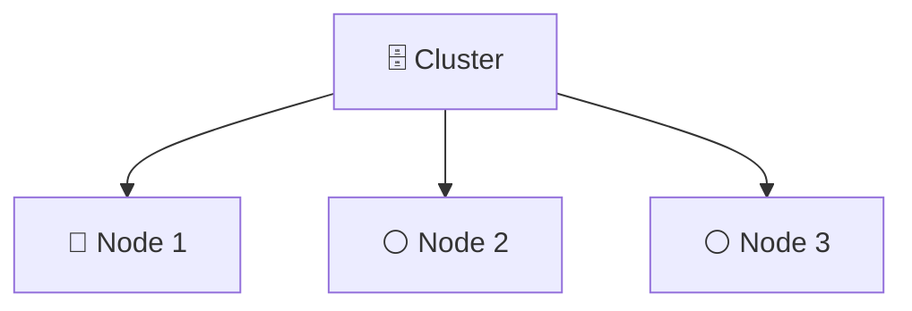
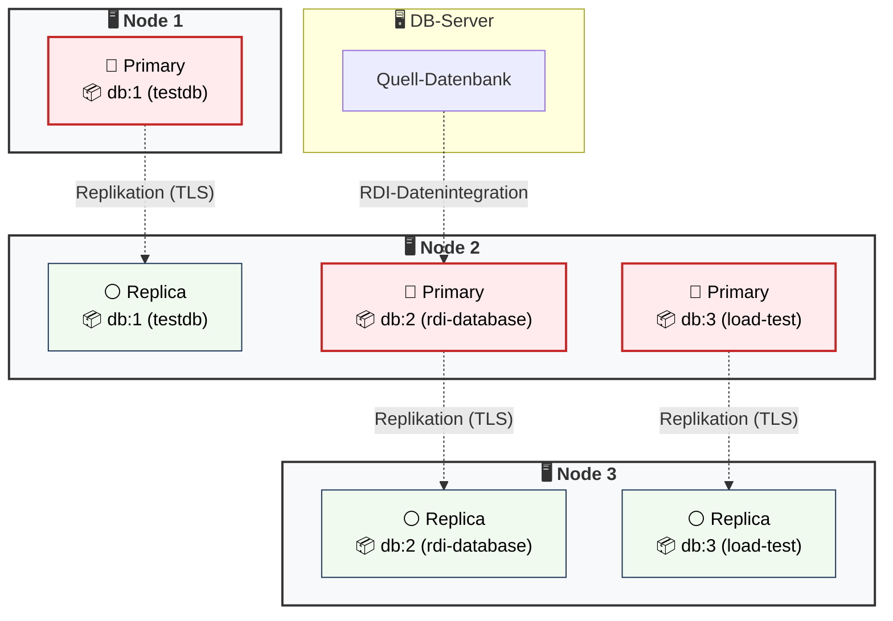

# Redis Enterprise – Linux (3-Node Cluster)

[English](README.md) · [Datenbankübersicht](../../README-de.md) · [BSI-Alignment](../../../README-de.md#bsi-alignment)

Diese Anleitung beschreibt eine native Redis-Enterprise-Installation auf drei Linux-Knoten. Es gibt hier keine Compose-Datei oder zentral einzuspielende `redis.conf`. Paketversion, unterstütztes Betriebssystem, Lizenz, DNS und Netzfreigaben vorab festlegen. Die gezeigten Datenbanken und Platzierungen sind Beispiele, keine automatisch erzeugte Topologie.

- [Installation und Cluster Setup](#installation-und-cluster-setup)
- [Cluster Aufbau](#cluster-aufbau)
  - [Infrastruktur & Nodes](#infrastruktur--nodes)
  - [Datenbanken](#datenbanken)
- [Sichere Datenbankkonfiguration](#sichere-datenbankkonfiguration)
  - [TLS & Verschlüsselung](#tls--verschlüsselung)
  - [Netzwerk & Ports](#netzwerk--ports)
  - [Nutzerverwaltung](#nutzerverwaltung)
  - [Protokollierung](#protokollierung)
  - [Persistenz, Backups und Restore](#persistenz-backups-und-restore)
  - [Hochverfügbarkeit (HA)](#hochverfügbarkeit-ha)
  - [Zusammenfassung zur sicheren Konfiguration](#zusammenfassung-zur-sicheren-konfiguration)
- [Verwaltung & CLI-Befehle](#verwaltung--cli-befehle)
  - [Prüfung des Cluster-Status](#prüfung-des-cluster-status)
  - [Erweiterten Cluster-Gesamtstatus anzeigen](#erweiterten-cluster-gesamtstatus-anzeigen)
  - [Detaillierte Cluster-Tuning-Parameter](#detaillierte-cluster-tuning-parameter)
  - [Node Übersicht abrufen](#node-übersicht-abrufen)
  - [Cluster-Validierung durchführen](#cluster-validierung-durchführen)
  - [Informationen zur Datenbank anzeigen](#informationen-zur-datenbank-anzeigen)
- [Referenzen](#referenzen)

## Installation und Cluster Setup

**Installation:**

1. Eine zum Versionsstand 8.0.x passende Redis-Enterprise-Version aus den [Hersteller-Downloads](https://redis.io/downloads/) auswählen und die Plattformvoraussetzungen prüfen.
2. Datei entpacken mit `tar -xvf [Dateiname].tar`
3. Installation mit `sudo ./install.sh` starten und Anweisungen folgen
4. Nach erfolgreicher Installation sollte Management UI über `https://<node-hostname>:8443` erreichbar sein

**Cluster Setup:**

1. Management UI aufrufen
2. "Create new cluster" wählen
3. Admin Credentials erstellen
4. Lizenz und FQDN angeben
5. Speicher und Netzwerk konfigurieren
6. Mit "Create cluster" das Cluster erstellen

> [!TIP]
> **HA-Grundlage:** Die drei Nodes vor dem Anlegen produktiver Datenbanken auf **drei getrennte Racks beziehungsweise Availability Zones** verteilen. Anschließend Rack-Zone-Awareness aktivieren. Dadurch können Primary- und Replica-Shards über getrennte Fehlerdomänen platziert werden.

**Weitere Schritte:**

- Nodes dem Cluster hinzufügen
- Datenbanken anlegen
- Weitere Konfigurationen, siehe [📑 Sichere Datenbankkonfiguration](#sichere-datenbankkonfiguration)

---

## Cluster Aufbau

Beispielhafter Cluster-Aufbau mit 3 Knoten und 3 Datenbanken.

**3-Node Redis Enterprise Cluster** (Version `8.0.10`)

### Infrastruktur & Nodes



### Datenbanken

1. `db:1` (`testdb`)
2. `db:2` (`rdi-database`)
3. `db:3` (`load-test`)

**Verteilung der Datenbanken auf den Nodes:**

Redis Enterprise plant und verteilt Shards automatisch anhand von Datenbank-, Ressourcen- und Platzierungsrichtlinien. Für Produktionsdatenbanken Replikation und Rack-Zone-Awareness bewusst aktivieren; die resultierende Platzierung anschließend prüfen. Die TLS-Markierungen im Diagramm setzen aktivierte Datenverschlüsselung zwischen den Knoten voraus. RDI steht für Redis Data Integration; die gezeigte Datenintegration wird hier nicht eingerichtet.



---

## Sichere Datenbankkonfiguration

Redis Enterprise verwaltet seine Konfiguration selbst. Installationsdateien, Laufzeitdaten, Konfiguration und Dokumentation liegen je nach Installation unter anderem in diesen Verzeichnissen:

- `/opt/redislabs`
- `/var/opt/redislabs`
- `/etc/opt/redislabs`
- `/usr/share/doc/redislabs`

> [!NOTE]
> Anders als bei Redis Open Source wird keine zentrale `redis.conf` manuell gepflegt. Generierte Konfigurationsdateien nicht direkt bearbeiten; die Verwaltungsoberfläche, `rladmin` oder die REST-API verwenden.

Generell ist die Konfiguration hierarchisch aufgeteilt:

1. **Cluster-Ebene:** Globale Parameter und Cluster-Zustand.
2. **Datenbank-Ebene:** Jede Datenbank besitzt eigene Einstellungen und einen Client-Endpunkt. Proxies leiten Client-Befehle an die zuständigen Shards weiter.

Für die Konfiguration wird die Verwendung der Web UI empfohlen.

---

### TLS & Verschlüsselung

TLS für Client-Verbindungen aktivieren. Die Option „Between databases“ betrifft Verbindungen zu anderen Clustern für „Replica Of“ oder Active-Active-Synchronisation; die Verschlüsselung der Shard-Replikation innerhalb desselben Clusters wird separat konfiguriert.

#### Umsetzung in Management UI

1. "Databases" wählen
2. Datenbank auswählen
3. "Security" wählen
4. "TLS - Transport Layer Security for secure connections" aufklappen
5. TLS aktivieren und "Clients and databases + Between databases" wählen

Für die Datenkommunikation innerhalb des Clusters zusätzlich **Internode Encryption** je Datenbank aktivieren (`data_internode_encryption`). Sie schützt unter anderem Shard-Replikation und Proxy-zu-Shard-Verbindungen zwischen Knoten. Die bereits aktivierte Verschlüsselung der Steuerungsebene ersetzt diese Einstellung nicht.

#### Prüfen der Konfiguration mit rladmin

1. Befehl `rladmin status extra all` ausführen
2. Unter "ENDPOINTS" in der Spalte "SSL" den Eintrag für die jeweilige Datenbank prüfen

Die Endpoint-Anzeige belegt nicht die Internode-Verschlüsselung. Beide Einstellungen separat prüfen und eine Client-Verbindung mit CA- und Servernamensprüfung testen.

---

### Netzwerk & Ports

Die folgende Tabelle zeigt nur ausgewählte Zugänge, keine vollständige Firewall-Freigabeliste. Zusätzlich benötigte Cluster-, Replikations- und Verwaltungsports anhand der [Hersteller-Portliste](https://redis.io/docs/latest/operate/rs/networking/port-configurations/) für die gewählte Version prüfen. Alle Freigaben auf erforderliche Quellen und Ziele beschränken:

**WebUI Port:**

| Parameter | Portnummer | Dienst | Erlaubte Quell-Ziele |
| --- | --- | --- | --- |
| `cm_port` | `8443` | Management UI | Nur Admin-IPs |

**Datenbank-Port:**

| Portnummer (Beispiel) | Dienst | Erlaubte Quell-Ziele |
| --- | --- | --- |
| `12000` | `testdb` Proxy | Nur Applikations-Server |
| `12001` | `rdi-database` Proxy | Nur RDI-Worker / Ziel-Systeme |

---

### Nutzerverwaltung

Ein rollenbasiertes Zugriffskonzept mit minimalen Berechtigungen (Least Privilege) verwenden. **RBAC** steht für Role-Based Access Control und bezeichnet das Berechtigungsmodell. **Redis-ACLs** (Access Control Lists) legen erlaubte Befehle sowie Schlüssel- und Kanalzugriffe fest. Eine Rolle verbindet diese Regeln mit den zugänglichen Datenbanken; Benutzer erhalten Rollen. Verwaltungsrechte für den Cluster und Datenzugriffsrechte getrennt vergeben.

#### Umsetzung einer rollenbasierten Zugriffsberechtigung

Anlegen von Rollen und Nutzern:

1. Redis-ACLs mit den erforderlichen Zugriffsregeln erstellen.
2. Rollen anlegen und die Redis-ACLs den jeweiligen Datenbanken zuordnen. Für reine Anwendungskonten **Management role: None** setzen.
3. Benutzer anlegen und die benötigten Rollen zuweisen.
4. Den Zugriff mit diesen Benutzern prüfen.
5. Danach den Datenbankbenutzer `default` deaktivieren, sofern keine Kompatibilität mit Clients vor Redis 6 erforderlich ist.

#### Umsetzung in Management UI

ACL und Nutzer anlegen:

1. "Access Control" auswählen
2. Unter "Roles" → "Data ACLs" Redis-ACLs anlegen; unter "Roles" Rollen mit den benötigten Datenbank-/ACL-Zuordnungen anlegen
3. "Users" wählen, Benutzer anlegen und Rollen zuweisen

Zugriff ausschließlich über ACL-Benutzer aktivieren:

1. "Databases" wählen
2. Datenbank auswählen
3. "Security" wählen
4. "Edit" wählen
5. In "Access Control" den Punkt "Using ACL only" wählen und die benötigten Rollen und Redis-ACLs auswählen. Diese Rollen müssen bereits Benutzern zugewiesen sein.

---

### Protokollierung

#### Cluster Protokollierung

Cluster- und Managementereignisse werden in den vorgesehenen Ereignisprotokollen erfasst. Welche Aktionen im benötigten Detailgrad vorliegen, ist anhand der gewählten Version und Audit-Konfiguration zu prüfen; ein vollständiges Protokoll aller Datenbankbefehle wird hier nicht vorausgesetzt.

##### Log in Management UI ansehen

1. Auf Startseite zu "Cluster" wechseln
2. Menüpunkt "Logs" wählen, um die chronologische Liste der Cluster-Ereignisse einzusehen.

##### Log in CLI abrufen

Die Protokolle befinden sich standardmäßig im Verzeichnis `/var/opt/redislabs/log`. Die wichtigsten Dateien sind:

* `event_log.log`: Zentrale Cluster- und Management-Events.
* `redis/`: Laufzeit-Logs der Redis-Shards; konkrete Dateinamen und IDs auf dem jeweiligen Node prüfen.

#### Datenbank Protokollierung

##### Slow Log

Überwachung von Befehlen mit hoher Laufzeit auf Shard-Ebene.

Es wird empfohlen, die folgenden Parameter an die Gegebenheiten der Umgebung anzupassen.

| Parameter           | Bedeutung                    | Empfehlung |
|---------------------|------------------------------|------------|
| `slowlog-log-slower-than` | Schwellwert, ab dem Vorgänge protokolliert werden | 10.000 µs (systemabhängig) |
| `slowlog-max-len` | maximale Anzahl der gespeicherten Einträge | 128 (systemabhängig) |

#### Log-Zentralisierung (SIEM/Syslog)

Die benötigten Cluster- und Audit-Ereignisse an ein zentrales Log-Management- oder SIEM-System weiterleiten. Dafür eine unterstützte Weiterleitung oder einen Log-Agenten einrichten und die Übertragung mit TLS absichern. Ereignisabdeckung und Transportverschlüsselung separat prüfen.

---

### Persistenz, Backups und Restore

Persistenz und periodische Backups sind getrennte Schutzmechanismen:

- **Persistenz** (Append-Only File/AOF oder RDB-Snapshots) ermöglicht Wiederherstellung aus den auf Datenträger gespeicherten Daten.
- **Periodische Backups** ermöglichen Wiederherstellung nach schwerwiegenderen Fehlern.

Für jede Produktionsdatenbank Backup-Ziel, Aufbewahrung, Zugriffsschutz/Verschlüsselung sowie einen regelmäßigen Restore-Test festlegen und dokumentieren.

##### Backup in Management UI einrichten

1. Auf Startseite "Databases" wählen
2. Menüpunkt "Configuration" wählen
3. Sektion "Durability" aufklappen
4. Mit "+Add backup path" Pfad für das Backup festlegen
5. Intervall für das Backup definieren

---

### Hochverfügbarkeit (HA)

Die Hochverfügbarkeit von Redis Enterprise basiert auf einer automatisierten Primary-Replica-Architektur auf Shard-Ebene.
Replikation und Replica-HA je Datenbank ausdrücklich prüfen und aktivieren. Bei aktivierter Replikation kann nach einem Primary-Ausfall die Replica zum neuen Primary befördert werden. „Replica high availability“ hilft zusätzlich, nach einem Node-Ausfall verlorene Replicas wiederherzustellen.

#### Prüfen/Aktivieren der Hochverfügbarkeit

1. Auf Startseite "Databases" wählen
2. Menüpunkt "Configuration" wählen
3. Sektion "High Availability" aufklappen
4. "Replication" aktivieren
5. "Replica high availability" aktivieren

---

### Zusammenfassung zur sicheren Konfiguration

* **Transportverschlüsselung (TLS) aktivieren:** Für alle Datenbanken sollte TLS aktiviert werden, da sonst unverschlüsselte Daten im internen Netzwerk im Klartext mitgelesen werden können.
* **Restriktive Firewall-Regeln anwenden:** Die kritischen Management-Ports (z.B. `8443`) sollten nur für Admin-IPs freigegeben sein. Generell sollte über Firewall Regeln die Zugriffe auf die verschiedenen Ports der Nodes geprüft werden.
* **Rollenbasierten Zugriff (RBAC) umsetzen:** Datenbankzugriff über Rollen und Redis-ACLs auf die benötigten Befehle, Schlüssel und Kanäle beschränken; Cluster-Verwaltungsrechte separat vergeben.
* **Log-Zentralisierung mittels Syslog einrichten:** Alle Cluster- und Audit-Ereignisse sollten an ein zentrales SIEM-System weitergeleitet werden.
* **Backups konfigurieren:** Jede Datenbank benötigt zyklische Backups auf externem Speicher.
* **Hochverfügbarkeit aktivieren:** Replikation für alle Produktivdatenbanken aktivieren, und die Ausfalltoleranz einschließlich der Platzierung und verfügbaren Ressourcen prüfen.
* **Keine manuellen Datei-Edits durchführen:** Konfiguration über Management UI, `rladmin` oder die REST-API ändern.
* **Internode Encryption:** Datenkommunikation zwischen den Knoten zusätzlich zur Client-TLS-Konfiguration verschlüsseln.

---

## Verwaltung & CLI-Befehle

### Prüfung des Cluster-Status

```bash
rladmin status
```

### Erweiterten Cluster-Gesamtstatus anzeigen

Zeigt zusätzliche Status- und Topologieinformationen; dies ist keine vollständige Messung von Replikationsverzögerung oder Migrationsfortschritt:

```bash
rladmin status extra all
```

### Detaillierte Cluster-Tuning-Parameter

```bash
rladmin info cluster
```

### Node Übersicht abrufen

```bash
rladmin info node
```

### Cluster-Validierung durchführen

Mit den integrierten Validierungs-Tools von Redis Enterprise kann der Zustand des Clusters überprüft werden:

```bash
rladmin status issues_only
rladmin verify rack_aware
rlcheck
```

### Informationen zur Datenbank anzeigen

Um eine verschlüsselte Verbindung mit spezifischen ACL-Benutzern zu einer Datenbank aufzubauen und Infos abzufragen, kann dieser Befehl genutzt werden:

```bash
redis-cli \
  -h <FQDN> \
  -p <PORT> \
  --tls \
  --cacert /path/to/trusted-ca.pem \
  --user <USER> \
  --askpass
```

Das CLI-Beispiel belegt TLS mit CA-Prüfung, aber keine allgemeine Servernamensprüfung: Im Upstream-Code von `redis-cli` 8.0 wird der Zertifikatspfad geprüft; `--sni` allein ergänzt keinen Hostnamenabgleich. Den tatsächlich eingesetzten Client prüfen und für produktive Verbindungen einen Client mit aktivierter CA- **und** Servernamensprüfung verwenden.

Alternativ zur Passworteingabe kann mit `REDISCLI_AUTH` das Passwort als Umgebungsvariable gesetzt werden.

Hostname, Port, CA-Pfad und ACL-Nutzer durch die tatsächlichen Werte ersetzen. Für `INFO` und `SLOWLOG` muss der Nutzer die entsprechenden Leserechte besitzen. Nach erfolgreichem Verbindungsaufbau:

```redis
INFO
SLOWLOG LEN
```

---

## Referenzen

- [Redis 8.0: TLS-Implementierung des CLI-Clients](https://github.com/redis/redis/blob/8.0.0/src/cli_common.c#L36-L89)
- [Redis: rladmin status](https://redis.io/docs/latest/operate/rs/references/cli-utilities/rladmin/status/)
- [Redis: rladmin info](https://redis.io/docs/latest/operate/rs/references/cli-utilities/rladmin/info/)
- [Redis: Replica HA](https://redis.io/docs/latest/operate/rs/databases/configure/replica-ha/)
- [Redis 8.0: Rollen und Redis-ACLs](https://redis.io/docs/latest/operate/rs/8.0/security/access-control/create-db-roles/)
- [Redis 8.0: Default-Benutzer verwalten](https://redis.io/docs/latest/operate/rs/8.0/security/access-control/manage-users/default-user/)
- [Redis: TLS aktivieren](https://redis.io/docs/latest/operate/rs/security/encryption/tls/enable-tls/)
- [Redis 8.0: Internode Encryption](https://redis.io/docs/latest/operate/rs/8.0/security/encryption/internode-encryption/)

© 2026 – Sichere Datenbankkonfigurationen
